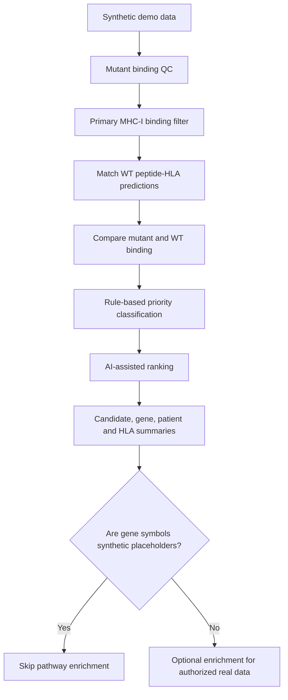

# Neoantigen Prioritization Workflow

All inputs and outputs in the public demonstration are synthetic.

This workflow demonstrates software processing and prioritization. It does not establish immunogenicity, vaccine efficacy, or clinical utility.
